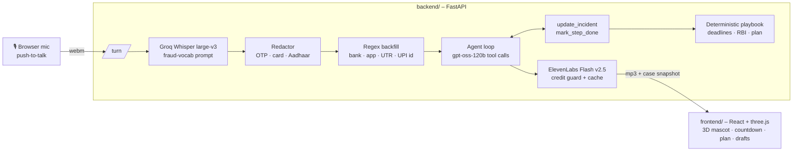

# GoldenHour 🛡️

**Voice first-aid for the first 60 minutes after an online scam.**

India loses ₹22,000+ crore a year to cyber fraud. Money can only be frozen if it is reported
in the *golden hour*, before it hops across mule accounts. But the victim, at that moment, is
shaking, rambling in Hinglish, and can't find a UTR number, let alone fill a portal form.

GoldenHour lets them **just talk**. Kavach, a calm 3D cartoon guardian, listens and turns the
panic into:

- a **structured case file** (amount, scam type, time, UTR, bank, scammer id),
- a **live golden-hour countdown** computed from *when* they say it happened ("15 minute pehle"),
- a **prioritised recovery plan** with real deadlines (1930, bank freeze, cybercrime.gov.in),
- the **RBI liability window** (zero liability within 3 *working* days: Sundays and 2nd/4th
  Saturdays skipped),
- **ready-to-file drafts**: the cybercrime.gov.in field packet and a bank dispute letter.

> Research behind the idea (15 candidate problems, scored): [docs/RESEARCH.md](docs/RESEARCH.md)


**Demo video (6 min):** a real run with live Whisper + gpt-oss + ElevenLabs, followed by a tour of the code.

## Architecture



### Design decisions

| Decision | Why |
|---|---|
| **LLM extracts, code decides** | The model understands messy Hinglish and phrases replies. Deadlines, steps, helplines and documents come from deterministic code, so it can't hallucinate a law or a phone number. |
| **Time is resolved in code** | The LLM only returns the *shape* (`minutes_ago=15`, `clock_time=21:00, day_offset=-1`); `clock.py` does the arithmetic and refuses future timestamps. |
| **Regex backfill under the LLM** | Bank names, payment apps, 12-digit UTRs, UPI ids and phone numbers have rigid shapes; if the model drops one, a regex pass over the user's own words fills it. |
| **Context-aware redaction** | A UTR and an Aadhaar are both 12 digits. UTRs are evidence (kept); Aadhaar/OTP/card numbers are secrets (masked) based on surrounding words and a Luhn check. |
| **Two LLM calls per turn** | Groq's free tier is 8k tokens/min. Every tool returns the updated plan, so a turn is *record → speak*. 429s get one retry, then a fallback to `gpt-oss-20b`. |
| **Deterministic language choice** | A tiny detector picks English vs Hinglish per turn; Hinglish replies are voiced with `language_code=hi` for proper pronunciation. |
| **TTS credit guard** | ElevenLabs spend is read from the `character-cost` header, persisted, capped, cached by hash, and falls back to the browser's free voice when the cap is hit. |

## Run it

```bash
# backend
cd backend
python3 -m venv .venv && .venv/bin/pip install -r requirements.txt
cp .env.example .env   # add GROQ_API_KEY and ELEVENLABS_API_KEY
.venv/bin/uvicorn app.main:app --port 8000

# frontend (new terminal)
cd frontend
npm install
npm run dev            # http://localhost:5173
```

Hold the button (or **Space**) and talk, in English, Hindi or Hinglish. You can also type.

```bash
cd backend && .venv/bin/python -m pytest -q   # deadline math, redaction, playbook, extraction
```

## Project layout

```
backend/app/
  agent.py      LLM loop, tool schemas, system prompt
  playbook.py   recovery steps, golden hour, RBI liability bands
  clock.py      IST time resolution, bank-holiday + working-day math
  extract.py    regex backfill + reply-language detection
  redact.py     OTP / card / Aadhaar masking that keeps UTRs
  documents.py  cybercrime.gov.in packet + bank dispute letter (templates)
  speech.py     Groq Whisper STT, ElevenLabs TTS with credit guard
  main.py       FastAPI routes
frontend/src/
  components/Mascot3D.tsx   cel-shaded three.js mascot with lip-sync + hour ring
  components/Panels.tsx     countdown, case file, plan, RBI meter
  components/DocsDrawer.tsx drafts with copy / download
  App.tsx, audio.ts, api.ts
```

## Disclaimer

GoldenHour is procedural first aid, not legal advice. Always call **1930** and your bank.
National/state bank holidays are not modelled in the working-day calculation.
