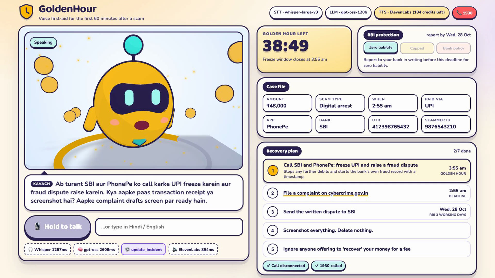
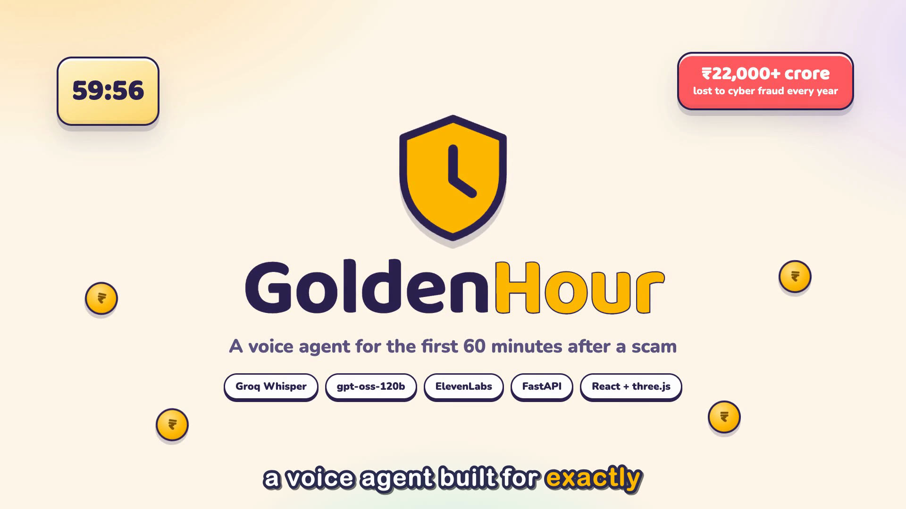
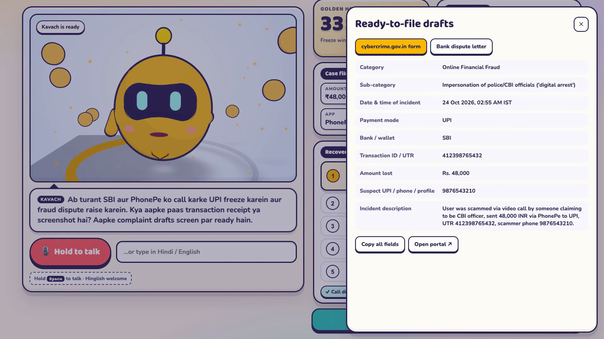
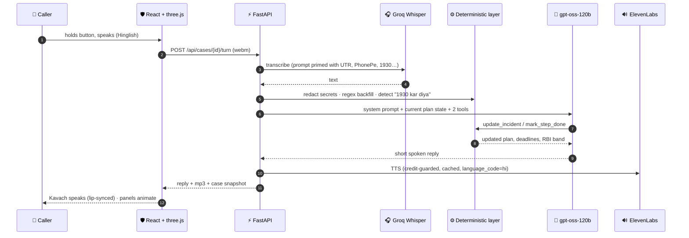
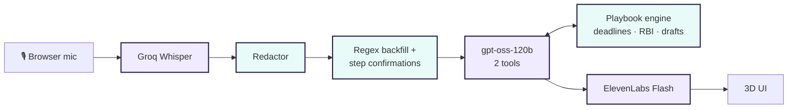

<div align="center">


# GoldenHour

### Voice first-aid for the first 60 minutes after an online scam

*Talk in Hindi, English or Hinglish. Kavach listens and builds your case, your countdown, your recovery plan and your complaint drafts.*


[The problem](#-the-problem) · [Demo](#-see-it-in-action) · [How it works](#-how-it-works) · [Engineering](#-engineering-decisions) · [Run it](#-run-it-locally) · [Research](docs/RESEARCH.md)



</div>

---

## 🚨 The problem

> *"I'm a CBI officer. A drugs parcel was seized in your name. Transfer the money now or you'll be arrested."*

- India loses **₹22,000+ crore a year** to cyber fraud, and "digital arrest" cases **tripled in two years** (~40k → ~1.24 lakh).
- Money can only be frozen in the **golden hour**: if it's reported on **1930** fast, banks put a hold on it before it's layered across mule accounts. Mumbai's helpline alone saved **₹241 crore** this way. After 3–15 days, it's mostly gone.
- RBI gives **zero liability** for third-party fraud only if the bank hears about it within **3 working days**.

At exactly that moment the victim is shaking. They can't find the UTR, don't know which portal to use, and aren't counting working days. **Panic kills typing, but people can still talk.** That's why this is a voice agent.

Scam *detectors* are everywhere. GoldenHour is built for the minutes **after** the scam.
How the idea was picked (5 research tracks, 15 scored ideas): **[docs/RESEARCH.md](docs/RESEARCH.md)**

## 🎬 See it in action

A real run with live Whisper, gpt-oss and ElevenLabs. Nothing was scripted on the agent side.

| 🧑 Caller (Hindi) | 🛡️ Kavach (Hinglish) | What changed on screen |
|---|---|---|
| *"A man on a video call said he's a CBI officer… I sent ₹48,000, 20 minutes ago. He's still on the line!"* | "Call ko turant kat dijiye…" *(hang up right now)* | Countdown starts at **40:00** · scam type = digital arrest · "Still on call!" |
| *"Okay, I hung up. Sent it from PhonePe, SBI account."* | "Ab turant 1930 par call karein…" | ✓ Call disconnected · bank + app captured |
| *"I called 1930, they took my complaint."* | "Ab SBI aur PhonePe ko call karke UPI freeze karein…" | ✓ 1930 called · plan re-prioritised |
| *"UTR is 4123 9876 5432, his number was 98765 43210."* | "…Aapke complaint drafts screen par ready hain." | Case file complete · **drafts unlocked** |

<table>
<tr>
<td width="50%"></td>
<td width="50%"></td>
</tr>
<tr>
<td align="center"><sub>6-minute walkthrough video (posted on LinkedIn)</sub></td>
<td align="center"><sub>cybercrime.gov.in packet + bank dispute letter, filled from the call</sub></td>
</tr>
</table>

## ✨ What it does

| | Feature | Detail |
|---|---|---|
| ⏱️ | **Golden-hour countdown** | Computed from what you *say* ("20 minute pehle", "kal raat 9 baje"), not from when you opened the app |
| 📋 | **Self-filling case file** | Amount, scam type, time, payment app, bank, UTR, scammer's number |
| ✅ | **Recovery plan with real deadlines** | Disconnect → 1930 → bank freeze → cybercrime.gov.in → written dispute. Steps tick themselves off as you talk |
| 🏦 | **RBI liability meter** | Zero / capped / bank-policy band, with the exact date. Skips Sundays and 2nd/4th Saturdays. Switches rules if an OTP was shared |
| 🧾 | **Ready-to-file drafts** | NCRP form fields + a bank dispute letter citing RBI/2017-18/15. Unknown fields say `[MISSING]` instead of guessing |
| 🔒 | **Privacy by default** | OTPs, card numbers and Aadhaar numbers are masked before anything is stored. UTRs are kept as evidence |
| 🗣️ | **Hinglish in, Hinglish out** | Replies in the caller's language, voiced with Hindi pronunciation |
| 🔁 | **Survives a refresh** | The case lives in the URL (`?case=…`), so a panicked reload loses nothing |

## 🧠 How it works





<sub>Purple = AI model · Green = deterministic code</sub>

## 🛠️ Engineering decisions

**The LLM extracts. The code decides.** The model is good at understanding a panicked, code-mixed story and phrasing a calm reply. Everything that must be *correct* lives in plain Python.

| Decision | Why |
|---|---|
| **Only two tools** | `update_incident` and `mark_step_done`. Steps, helplines, deadlines and documents come from `playbook.py` and `documents.py`, so the model can't invent a law or a phone number. |
| **Time math in code** | The model returns only the *shape* (`minutes_ago=15` or `clock_time="21:00", day_offset=-1`). `clock.py` does the arithmetic and refuses future timestamps. |
| **Two LLM calls per turn** | Groq's free tier allows 8k tokens/min. Every tool returns the updated plan, so a turn is *record → speak*. A 429 gets one retry, then falls back to `gpt-oss-20b`. |
| **Context-aware redaction** | A UTR and an Aadhaar number are both 12 digits. One is evidence, one is a secret. Digits are masked only when nearby words say what they are; card numbers must pass a Luhn check. |
| **Regex backfill** | Bank names, payment apps, UTRs, UPI ids and phone numbers have rigid shapes. If the model drops one, a regex pass over the caller's own words fills it in. |
| **Deterministic language choice** | A tiny detector picks English vs Hinglish per turn, because LLMs drift towards their prompt's examples. |
| **TTS credit guard** | Spend is read from ElevenLabs' `character-cost` header, persisted to disk, capped, cached by hash, and falls back to the browser's free voice at the cap. |

### Guardrails that came from testing

Every failure found in end-to-end dry runs became a rule and a unit test:

| Failure seen | Guardrail |
|---|---|
| Model ticked "bank freeze" when the caller only said "1930 done" | It may only tick a step that the caller's words mention (`STEP_EVIDENCE`) |
| Model forgot to tick obvious steps | Phrases like *"1930 pe call kar diya"* / *"UPI freeze ho gaya"* tick steps directly |
| "15 minutes ago" repeated on a later turn shifted the clock | Repeated times within 10 minutes are treated as the same moment |
| Empty reply after reasoning | Nudge once, then speak the top playbook step |
| Phone number sent as an integer broke the case file | Coerce to text + `validate_assignment` on the model |
| PhonePe labelled as "wallet" | UPI apps are always normalised to the UPI channel |
| Groq tool-call validation errors | Resample instead of failing the turn |

## 🚀 Run it locally

**Prerequisites:** Python 3.11+, Node 18+, a [Groq](https://console.groq.com) key and an [ElevenLabs](https://elevenlabs.io) key.

```bash
git clone https://github.com/coolstack-coder/Voice_Agent.git
cd Voice_Agent
```

**Backend** (terminal 1)
```bash
cd backend
python3 -m venv .venv && .venv/bin/pip install -r requirements.txt
cp .env.example .env        # add your keys
.venv/bin/uvicorn app.main:app --port 8000
```

**Frontend** (terminal 2)
```bash
cd frontend
npm install
npm run dev                 # open http://localhost:5173
```

Hold the button (or **Space**) and talk. You can also type.

<details>
<summary><b>Environment variables</b></summary>

| Variable | Default | Purpose |
|---|---|---|
| `GROQ_API_KEY` | – | Whisper STT + gpt-oss LLM |
| `ELEVENLABS_API_KEY` | – | Kavach's voice |
| `TTS_PROVIDER` | `elevenlabs` | `browser` = free Web Speech voice (handy while developing) |
| `TTS_CREDIT_BUDGET` | `1000` | Hard cap on ElevenLabs credits this server may spend |
| `LLM_MODEL` | `openai/gpt-oss-120b` | Falls back to `gpt-oss-20b` on rate limits |
| `STT_MODEL` | `whisper-large-v3` | |
| `REASONING_EFFORT` | `medium` | gpt-oss reasoning effort |
| `TTS_VOICE_ID` / `TTS_MODEL` | Sarah / `eleven_flash_v2_5` | |

</details>

<details>
<summary><b>API</b></summary>

| Method | Route | |
|---|---|---|
| `GET` | `/api/health` | Models in use, TTS credits left |
| `POST` | `/api/cases` | Start a case |
| `GET` | `/api/cases/{id}` | Case snapshot (incident, plan, countdown, liability, transcript) |
| `POST` | `/api/cases/{id}/turn` | `audio` (file) or `text` (form) → reply, mp3, snapshot, timings |
| `POST` | `/api/cases/{id}/steps/{step}` | Toggle a plan step |
| `GET` | `/api/cases/{id}/documents` | NCRP packet + bank letter |

</details>

**Tests**
```bash
cd backend && .venv/bin/python -m pytest -v
```
13 tests cover IST time resolution, bank holidays and working days, redaction, the playbook, liability bands, regex extraction, step confirmations and the case store.

## 📁 Project layout

```
backend/                    FastAPI service
  app/agent.py              LLM loop, tool schemas, guardrails
  app/playbook.py           recovery steps, golden hour, RBI liability bands
  app/clock.py              IST time resolution, bank-holiday + working-day math
  app/extract.py            regex backfill, step confirmations, language detection
  app/redact.py             OTP / card / Aadhaar masking that keeps UTRs
  app/documents.py          cybercrime.gov.in packet + bank letter (templates)
  app/speech.py             Groq Whisper STT, ElevenLabs TTS with credit guard
  app/main.py               routes
  tests/test_core.py
frontend/                   React + Vite + three.js
  src/components/Mascot3D.tsx    cel-shaded mascot, ink outlines, lip-sync, hour ring
  src/components/Panels.tsx      countdown, case file, plan, RBI meter
  src/components/DocsDrawer.tsx  drafts with copy / download
  src/App.tsx · audio.ts · api.ts
docs/RESEARCH.md            problem discovery and scoring
```

## 🗺️ Roadmap

- [ ] **WhatsApp voice notes**: same agent, no app install
- [ ] **Bank fraud API hooks**: send the freeze request while the person is still talking
- [ ] **More languages**: Tamil, Bengali, Marathi
- [ ] National and state bank-holiday calendar for the RBI window

## ⚠️ Disclaimer

GoldenHour is procedural first aid, not legal or financial advice. **Always call 1930 and your bank.**

---

<div align="center">

Built by **Anmol Advani**

If someone you love ever gets that call, remember one number: **1930**.

</div>
